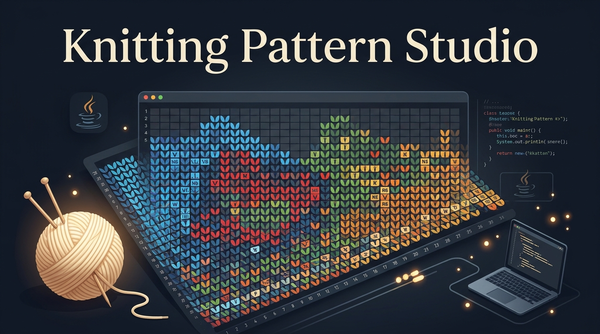
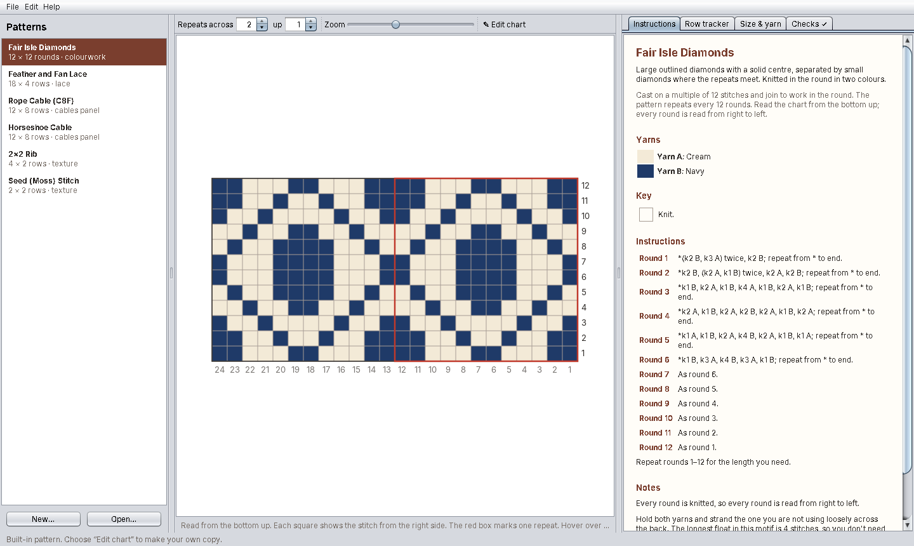
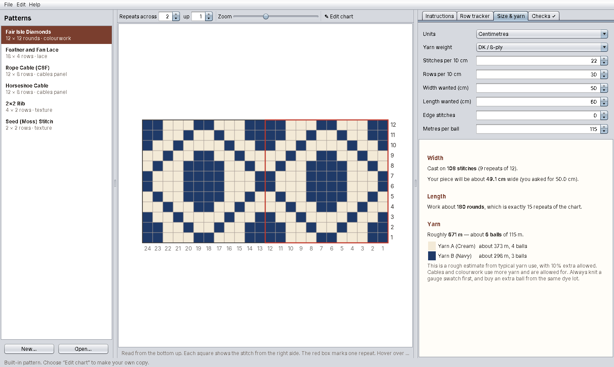
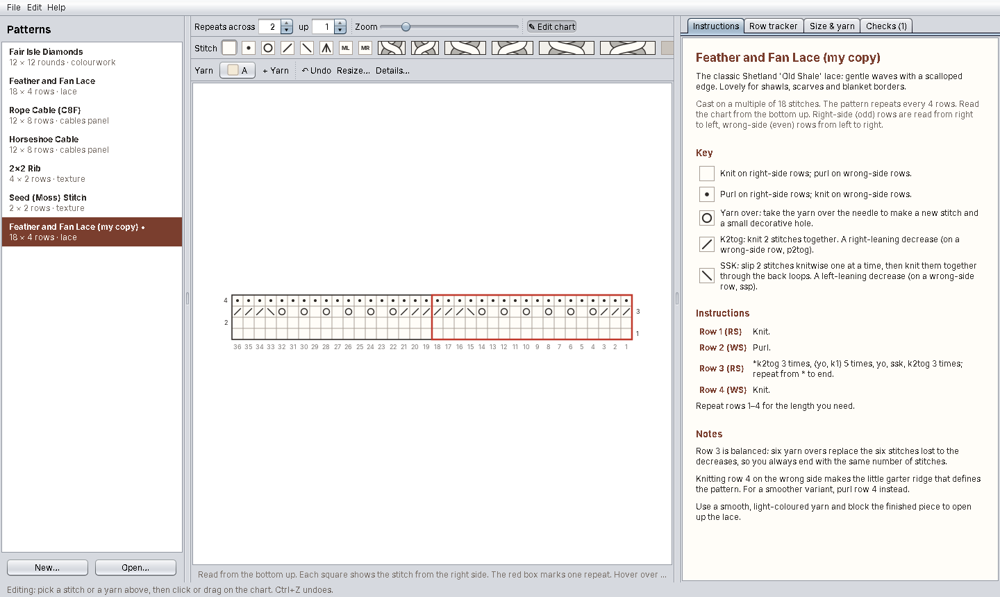

# Knitting Pattern Studio

**Design, view and follow knitting charts on your computer — free.**

Knitting Pattern Studio shows a knitting chart and its written, row-by-row instructions side by side. Both come from the same chart, so they always agree. It keeps your place as you knit, works out how many stitches to cast on and roughly how much yarn to buy, and checks your own designs for mistakes before you pick up your needles.



---

## What it does

- **Charts you can read easily.** Proper knitting symbols, row numbers on the correct side, stitch numbers along the bottom, and a red box around one repeat. Zoom in, and show the repeat several times across and up to see how the fabric will look.
- **Written instructions, made for you.** Every chart comes with row-by-row instructions such as *"\*k2tog 3 times, (yo, k1) 6 times, k2tog 3 times; repeat from \* to end."* Wrong-side rows are turned around for you, so you never have to work out "purl the knits" in your head.
- **A row tracker.** Shows one row at a time in large print and highlights it on the chart. Press *Done — next row* as you go. Your place is saved, so you can close the program and pick up where you left off.
- **A size and yarn calculator.** Enter your gauge and the size you want. It tells you how many stitches to cast on (rounded to whole repeats), how many rows to work, and roughly how much yarn you need, split by colour for colourwork.
- **A chart designer.** Paint stitches and colours onto a grid. The instructions update as you draw.
- **Mistake checks.** It warns you if a row needs more stitches than the row before left on the needle, if a cable is drawn the wrong width, or if a colourwork float is long enough to snag.
- **Print and share.** Print the pattern, save it as a web page to email or open on a tablet, or save the chart as a picture.

---

## Getting started

You need two things: **Java** (a free program that runs Knitting Pattern Studio) and the file **`KnittingPattern.java`** from this page.

### 1. Install Java (once)

1. Go to **[adoptium.net](https://adoptium.net)**.
2. Click the big download button. It picks the right version for your computer.
3. Open the downloaded file and follow the installer, accepting the suggested options.

Any version from **Java 17** upwards will work. If you already have Java, you can skip this step.

### 2. Download the program

At the top of this page, click **`KnittingPattern.java`**, then the **download** button (the arrow pointing down, on the right). Save it somewhere easy to find, such as your **Documents** folder.

### 3. Start it

**On Windows**
1. Open the folder containing `KnittingPattern.java`.
2. Click in the address bar at the top of the window, type `cmd` and press **Enter**. A black window opens.
3. Type the following and press **Enter**:
   ```
   java KnittingPattern.java
   ```

**On a Mac**
1. Open **Terminal** (press ⌘ + Space and type *Terminal*).
2. Type `cd ` (with a space after it), drag the folder containing `KnittingPattern.java` into the Terminal window, and press **Return**.
3. Type the following and press **Return**:
   ```
   java KnittingPattern.java
   ```

**On Linux:** open a terminal in the folder and run `java KnittingPattern.java`.

The window takes a few seconds to appear the first time. Leave the black or Terminal window open while you use the program.

---

## A quick tour

The window has three parts:

| Left | Middle | Right |
|---|---|---|
| Your **list of patterns**. Click one to open it. | The **chart**. Hover over any square to see which row and stitch it is. | Four tabs: **Instructions**, **Row tracker**, **Size & yarn** and **Checks**. |

Above the chart:
- **Repeats across / up** show the pattern repeated, so you can see how it tiles. Panels, such as a single cable, are shown once.
- **Zoom** makes the squares bigger or smaller.
- **✎ Edit chart** switches to design mode (see *Designing your own pattern* below).

### Instructions

The complete written pattern: cast-on, yarns, a key with every symbol used, the row-by-row instructions and any notes. A row that is the same as an earlier one says *"As row 1"*, as printed patterns do.

### Row tracker


The tracker shows the row you're about to knit in large print, says whether it's a right-side or wrong-side row, and previews the row after it. The row is also highlighted on the chart.

- **Done — next row** moves on one row.
- **Back a row** is for when you rip back.
- **Go to row…** jumps to any row. Count from your cast-on: if you're on your third repeat of an 8-row cable, that's row 17 onwards. The tracker works out where that falls on the chart.
- **Start again** goes back to row 1.

Each pattern remembers its own place, so you can keep a scarf and a hat on the go at the same time.

### Size & yarn



1. Choose **centimetres or inches**.
2. Choose your **yarn weight**. This fills in typical gauge figures. If you've knitted a gauge swatch, which is always a good idea, type in your own numbers instead.
3. Enter the **width** and **length** you want, any **edge stitches** (for example, 2 for a selvedge stitch at each side), and how many metres or yards are in one ball of your yarn.

It then tells you:
- **How many stitches to cast on**, rounded to whole pattern repeats, and the actual width that gives you.
- **How many rows to work**, and where to stop so you finish at the end of a repeat.
- **About how much yarn you need**, in total and per colour for colourwork.

> The yarn amount is an estimate based on typical yarn use. It allows extra for cables and colourwork, and adds 10% on top. Always buy an extra ball from the same dye lot.

### Checks

Every chart is checked automatically. The tab shows **Checks ✓** when all is well, or a number when there's something to look at. It checks:

- **Stitch counts.** Each square on a chart is one stitch left on your needle after the row. A k2tog uses two stitches but fills one square; a yarn over adds one. If a row would need more or fewer stitches than the previous row left behind, you're told exactly which row.
- **Right-side stitches.** Cables, double decreases and make-ones belong on right-side rows.
- **Cable widths.** A C6F needs exactly 6 squares.
- **Long floats.** In colourwork, a strand carried behind more than 5 stitches can catch on fingers and jewellery. You're told where to catch it.

---

## Reading the chart

If you're new to charts, choose **Help → How to read a chart**. In short:

- **Start at the bottom.** Row 1 is the bottom row.
- **Each square is one stitch**, drawn as it looks from the **right side** (the outside) of your work.
- **Knitting flat:** right-side rows have their number on the **right** and are read **right to left**. Wrong-side rows have their number on the **left** and are read **left to right**, doing the opposite of what you see: blank squares are purled and dots are knitted. The written instructions do this for you.
- **Knitting in the round:** every round is read from right to left, and every number is on the right.
- **The red box** is one repeat. Work it across the row as many times as your stitches allow.

### Symbols

| Symbol | Name | What to do |
|:---:|---|---|
| (blank) | Knit | Knit on right-side rows, purl on wrong-side rows |
| • | Purl | Purl on right-side rows, knit on wrong-side rows |
| ○ | Yarn over | Take the yarn over the needle to make a stitch and a little hole |
| ╱ | K2tog | Knit 2 together (leans right). On a wrong-side row, p2tog |
| ╲ | SSK | Slip, slip, knit (leans left). On a wrong-side row, ssp |
| Λ | SK2P | Slip 1, k2tog, pass the slipped stitch over (3 stitches become 1) |
| ML / MR | M1L / M1R | Make one, leaning left / right |
| crossing strands | C4F, C4B, C6F, C6B, C8F, C8B | Cables. **F** = hold the cable needle at the **front** (the cable leans left); **B** = hold it at the **back** (it leans right) |
| grey square | No stitch | A placeholder. Skip it |

---

## Patterns included

| Pattern | Type | Repeat |
|---|---|---|
| **Fair Isle Diamonds** | Two-colour stranded knitting, in the round | 12 stitches × 12 rounds |
| **Feather and Fan Lace** | The classic Shetland "Old Shale" lace | 18 stitches × 4 rows |
| **Rope Cable (C8F)** | A bold cable panel | 12 stitches × 8 rows |
| **Horseshoe Cable** | Two cables crossing away from each other | 12 stitches × 8 rows |
| **2×2 Rib** | Stretchy ribbing for cuffs and brims | 4 stitches × 2 rows |
| **Seed (Moss) Stitch** | A flat, reversible bumpy texture | 2 stitches × 2 rows |

The built-in patterns can't be changed by accident. If you edit one, the program makes your own copy first.

---

## Designing your own pattern



1. Choose **New…** (bottom left). Give the pattern a name, choose how many stitches wide and rows high one repeat is, and how many colours it uses. Tick **Knitted in the round** or **A single panel** if they apply.
2. The chart opens in **edit mode**. Two rows of buttons appear above it:
   - **Stitch:** click a symbol, then click or drag across the chart to paint it. For a cable, click the **leftmost** square of where it should go, and it fills the right number of squares.
   - **Yarn:** click a colour, then click or drag to paint that colour. **Right-click** a colour to rename it ("Heather grey") or choose its exact shade. **+ Yarn** adds another colour.
   - **Undo** (or Ctrl+Z / ⌘+Z) takes back the last change. **Resize…** changes the size of the chart. **Details…** sets the name, a description, your own notes, and whether it's knitted in the round.
3. Watch the **Instructions** and **Checks** tabs update as you draw.
4. Choose **File → Save as…** to keep it. Your patterns are saved as small `.knit` files that you can email to a friend. They open them with **Open…**.

Patterns with unsaved changes show a **•** after their name, and the program reminds you before you quit.

---

## Printing and sharing

From the **File** menu:

| Option | What you get |
|---|---|
| **Print…** | The chart on the first page, then the key, instructions and notes |
| **Export as web page (HTML)…** | A single file that opens in any web browser, on a computer, tablet or phone. It contains the chart, key, instructions and notes, and prints neatly. Good for emailing |
| **Export chart as picture (PNG)…** | A high-quality image of the chart, for a blog, Ravelry or a notebook |
| **Export as plain text…** | The whole pattern as simple text, with the chart drawn in letters |

---

## Questions

**Is it really free?** Yes. It's open source under the MIT licence (see below).

**Does it need the internet?** No. Everything happens on your computer.

**Where is my row-tracker position kept?** In your computer's user settings, so it survives restarts. Each pattern has its own position, looked up by the pattern's name.

**Why is a decrease only one square?** A chart shows the stitches you **end up with** after each row. A k2tog turns two stitches into one, so it takes one square. That's why lace rows, where each decrease is paired with a yarn over, keep the same width.

**My cable chart says "a C6F cable needs 6 squares".** Part of the cable was painted over. Click the leftmost square of the cable again with the cable selected.

**Can I use it without the window, in a terminal?** Yes. `java KnittingPattern.java --text` prints every pattern, chart and all, as text. Add `--pattern lace` to show just the patterns whose name contains "lace", or `--no-colour` for plain text.

---

## For the technically minded

- The whole program is a single Java file using only Java's built-in libraries, so there's nothing else to install or build. It runs with Java's source launcher on Java 17 or newer.
- Each pattern is a grid of `Stitch` values (with how many stitches each one uses and makes) plus a yarn index per square. The written instructions, key, stitch-count checks, printing and row tracker are all generated from that grid.
- `.knit` files are plain text: a few `key: value` lines, then the chart drawn with one character per stitch (`.` knit, `-` purl, `O` yarn over, `/` k2tog, `\` ssk, `^` sk2p, `L`/`R` make one, `F`/`B`/`G`/`H`/`X`/`Y` cables, `#` no stitch), and an optional block of yarn letters for colourwork. You can write or edit them in any text editor.
- If no display is available, the program falls back to text mode automatically.

---

## Licence

MIT. You're free to use, copy, change and share it. Happy knitting! 🧶
